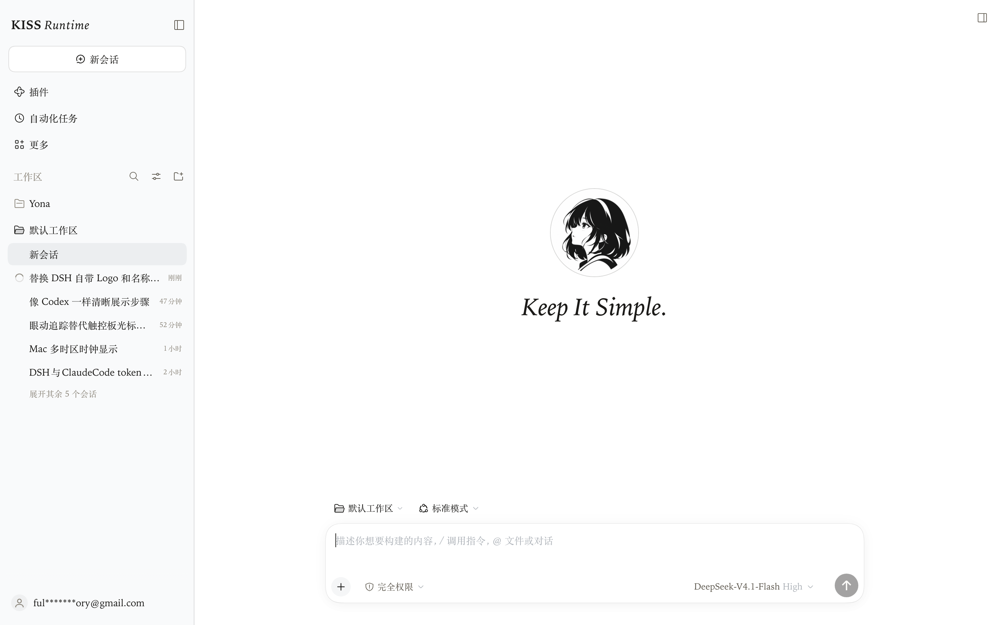
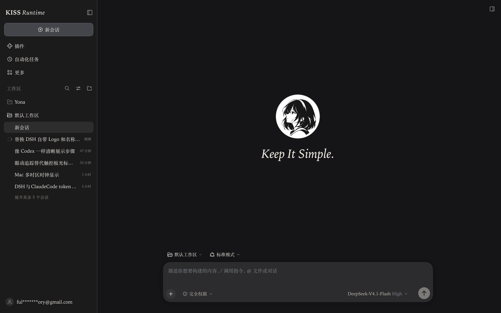

# KISS Runtime for DSH

把 DeepSeek Harness（DSH）Web 客户端换成 **KISS Runtime** 的两个 DSH 插件包：品牌外观层 + 对话排版层。不修改 DSH 安装包，不碰 DSH 源码，只占用官方留出的品牌槽位和对话渲染契约。





## 两层是什么

| 包 | 显示名 | 作用 |
| --- | --- | --- |
| [`packages/kiss-brand`](packages/kiss-brand/README.md) | **KISS Runtime UI** | 侧栏衬线字标、首页圆形肖像与 `Keep It Simple.`、中性单色主题、衬线界面字体、页面/窗口标题与 favicon、只保留 `用时 …` 的运行状态 |
| [`packages/kiss-output`](packages/kiss-output/README.md) | **KISS Runtime Output** | 只改对话排版：回复的小节标题、安静的工具行、最新一轮 shell 命令默认展开、思考收成一个标签 |

两层互相独立：只装 `kiss-brand` 就是纯换皮；`kiss-output` 只负责转写稿的排版，不改执行行为。

## 环境要求

- DSH 0.2.2-rc.3（Desktop 版）实测可用；`kiss-output` 声明了 `engines.dsh >= 0.2.2-rc.1`。
- 不需要单独装 pnpm：Desktop 版自带应用级包管理器。
- 需要能访问这个私有仓库（见[访问权限](#访问权限)）。

## 安装

三个方式选一个。**先装 `kiss-brand`，再装 `kiss-output`**，两步都在 **Plugins → Add plugin** 里完成，装完在 Plugins 页面把两张卡片都打开。

### 方式 A：克隆后按本地目录安装（推荐）

```sh
git clone https://github.com/YonaQuantum/dsh-kiss-runtime.git
```

1. Plugins → **Add plugin**，填入绝对路径（把 `<clone>` 换成实际路径）：
   - `<clone>/packages/kiss-brand`
   - `<clone>/packages/kiss-output`
2. 每装完一个点 **Enable now**。
3. 回首页确认侧栏变成 `KISS Runtime`、首屏是圆形肖像 + `Keep It Simple.`。

这种方式在 profile 里记录的是 `link:` 到克隆目录，**不要删除或移动这个目录**，否则插件会失效。

### 方式 B：直接在 Add plugin 里填 Git 地址

不克隆，安装时由 pnpm 去拉仓库：

```
github:YonaQuantum/dsh-kiss-runtime#path:packages/kiss-brand
```

```
github:YonaQuantum/dsh-kiss-runtime#path:packages/kiss-output
```

前提是本机 Git 已经能读这个私有仓库：登录过 `gh auth login`，或配好了 SSH key（pnpm 对 GitHub 会先试 HTTPS，失败再回退 SSH）。没有配置过的，用方式 A 或 C 更省事。

Git 形式安装的插件不支持“检查新版本”，升级时先卸载再按同样地址重装。

### 方式 C：下载 ZIP 后按本地目录安装

在 GitHub 页面点 **Code → Download ZIP**（需要登录且对该仓库有权限），解压后按方式 A 的第 1 步填本地路径。适合不想配 Git 凭据的朋友。

## 卸载与恢复

- Plugins 页面把两张卡片关掉即可停用；点 **Uninstall** 彻底移除。
- `kiss-brand` 关闭了官方的 `ui-brand-official` 行；卸载后官方品牌/字体自动恢复，不用手改配置。
- 如果同时装了别的品牌插件，会和 `kiss-brand` 抢同一组单占位槽位，只能二选一。

## 已知边界

- 能改：页面标题、Electron 窗口标题、favicon、apple-touch-icon、Plugins 卡片图标。
- 不能改：macOS 菜单栏最左侧的应用名、Dock / Finder / Launchpad 的图标和名称——它们来自已签名的 `.app`（`Info.plist` / `icon.icns`），插件拿不到，硬改会破坏代码签名和自动更新。
- 首屏加载时、插件挂载前一闪而过的启动字标属于桌面壳资源，插件改不到。
- `kiss-output` 依赖 DSH 公开的对话 DOM 契约（`data-chat-flow-kind`、`data-variant` 等）。DSH 大版本升级若改了这些标记，最坏情况是排版层失效、界面回到原样，不会报错或卡住。

## 目录

```
packages/kiss-brand    @local/kiss-brand  1.5.3  外观层
packages/kiss-output   @local/kiss-output 0.1.0  对话排版层
docs/                  效果截图
```

包名里的 `@local` 只是本地占位，不需要发布到 npm，不影响安装。

## 访问权限

仓库是 **private**。朋友要用，需要把这个仓库加为 collaborator：

- GitHub 仓库页 → **Settings → Collaborators → Add people**，输入对方的 GitHub 用户名；
- 或让对方把用户名给你，用 `gh api -X PUT repos/YonaQuantum/dsh-kiss-runtime/collaborators/<用户名>` 添加。

加完对方才能 clone / 下载 ZIP / 用 Git 地址安装。
