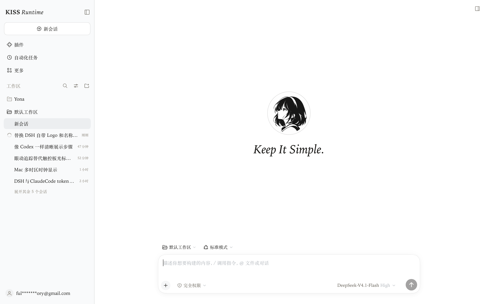
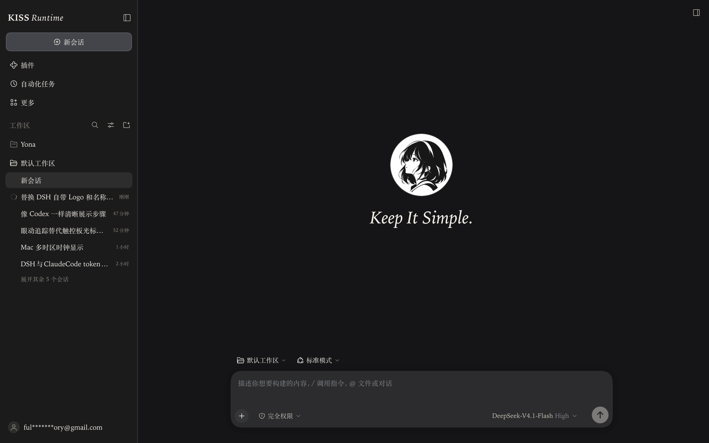

# KISS Runtime UI

外观层。把 DSH Web 客户端里的 DeepSeek Harness 替换成 **KISS Runtime**：品牌、字体、配色、首页与运行状态。不修改安装包，也不碰 DSH 源码；它只占用官方留下的品牌槽位。

对话内容的排版不在这里。小节标题、工具行、命令与输出的节奏由独立插件 [`@local/kiss-output`](../kiss-output/README.md) 负责，两层可以分别启用或停用。






## 替换了什么

| 位置 | 之前 | 现在 |
| --- | --- | --- |
| 侧栏展开态 | 鲸鱼标志 + DeepSeek Harness | 衬线体 `KISS Runtime`，无图形 Logo |
| 侧栏收起态 | 鲸鱼标志 | 无 Logo（只保留侧栏控件） |
| 新会话首屏 | 动画鲸鱼 + 探索未至之境 + 预览版 | 圆形肖像图标 + `Keep It Simple.`；对话框在正常任务位置 |
| 对话运行状态 | 摇尾巴鲸鱼 + `深度求索中，用时 …` | 只保留 `用时 …` |
| 主题色 | DeepSeek 蓝 | 中性白 / 墨黑单色（背景保持不变） |
| 整体界面字体 | 系统无衬线 | 衬线体（代码、终端仍保持等宽） |
| 页面/窗口标题 | `DeepSeek Harness` / `会话 — DeepSeek Harness` | `KISS Runtime` / `会话 — KISS Runtime` |
| 浏览器标签 / PWA 图标 | 鲸鱼 | 黑白肖像（`assets/app-icon-64.png`） |
| Plugins 页面卡片 | 渐变 K | 黑白肖像（`assets/app-icon-128.png`） |
| macOS Dock / Finder / Launchpad 图标 | 鲸鱼 | 插件改不到，需改 `.app` 资源（见边界） |

官方 `ui-brand-official` 行由本插件的 `cordis.patch.yml` 关闭；它和本插件占的是同一组单占位槽，所以必须二选一。移除本插件后官方品牌会自动回来，不需要手工改配置。

## 设计

- 字标：`KISS` 用罗马体、`Runtime` 用斜体，衬线字体栈为 `New York → Iowan Old Style → Palatino → Baskerville → Georgia`，优先 macOS 的 New York / Iowan Old Style。
- 侧栏 18 px；首屏是圆形图标 128 px + 一行 36 px 的整句斜体 `Keep It Simple.`，没有小字。
- 首屏是一个启动页：圆形肖像图标居中，`Keep It Simple.` 在图标下，整体在对话框上方的剩余空间里垂直居中。图标纯白圆心 + 1 px 细边框，没有外发光、没有大阴影。
- 对话框（以及它上方的 Workspace / Agent 行）固定在页面底部，和正常执行任务时一致；插件给 hero 的 `composerStack` / `composerSeat` / `scrollBody` 打上 `data-kiss-hero-*` 标记，再用四条作用域样式把 hero 区域撑满、让品牌块居中、让输入框落底，不影响会话页。
- 首屏原来的 `探索未至之境` 和 `预览版` 是标题组里的兄弟节点；插件在挂载时给标题打上 `data-kiss-hero`，用一条作用域样式把整个标题组隐藏，页面上只剩图标和 `KISS Runtime / KEEP IT SIMPLE`。
- 整体字体走 `ui-theme` 的 `textFontFamily`（不是 `!important` 覆盖）：界面和对话正文使用同一衬线栈，并补上 `Songti SC / STSong / Noto Serif CJK` 让中文也是衬线；代码和终端继续走各自的等宽字体，跟 Claude 一样“正文衬线、代码等宽”。基准字号从 DSH 的 14 px 提到 15 px，并给正文加 `font-weight:500` 和 0.25 px 的 `-webkit-text-stroke`：macOS 的宋体只有 Regular / Bold 两档，直接跳 Bold 太重，这一丁点描边相当于补出一个 Medium，中文不再发虚；代码块显式清掉描边，保持等宽字体的干净边缘。字号和字体写在**本插件的 `cordis.patch.yml`** 里，不写进 profile 的 `cordis.patch.yml`，这样禁用插件时字体会跟着回退。
- 主题色改为一组单色，但**不带暖色**：暗色下 `#F9FAFB` 为强调色（DSH 的 label-primary），`#CFD3D6` / `#ADB2B8` 为次级文字，选中底色用中性 `#353638`；亮色下用 `#0F1115` / `#61666B` / `#81858C`，选中底色 `#EBEEF2`。原来的 DeepSeek 蓝（选中 tab、活动文件夹、链接、发送按钮、焦点环、运行文字）全部映射到单色，并加 `!important` 和组件级兜底，退出重进/样式加载顺序变化也不会把蓝色带回来。**页面背景色没有改**：亮色是纯白 `#fff`，暗色是原来的 `#151517` / `#1b1b1c` 分层表面；之前整片发黄来自暖白前景色和暖灰选中底，现在都换回了 DSH 的中性色。
- 运行状态隐藏了摇尾巴鲸鱼，并把 `深度求索中，用时 …` 改写成 `用时 …`。DSH 的 `TextShimmer` 会在标签上再叠一层**平移的副本**做扫光（`_decoration` / `_sweep` / `_highlight`），缩短标签后这层副本会和正文错位，看起来像重影；现在把 `_decoration` 整层隐藏，`用时 …` 就是干净的静态文字。改写仍用 `MutationObserver` 同时盯 `characterData` 和 `data-shimmer-text` 属性，无障碍的 `深度求索中` 也换成 `正在生成`。
- 没有渐变方块、没有鲸鱼、没有图形 Logo；站点图标和 Plugins 卡片使用你给的黑白肖像，首页使用纯白圆形版本 + 细边框。
- 标题用 `MutationObserver` 改写布局层硬编码的 `DeepSeek Harness`，所以会话标题变化时仍是 `会话 — KISS Runtime`。

## 安装

在 DSH 的 Plugins 页面选择本地插件，或让 agent 调用 `plugin_manager` 的 `install_bundle`，target 指向本目录。安装后 HMR 会直接热更新；没有 HMR 的 profile 重启一次生效。

手工安装：

```yaml
# profile/package.json
"dependencies": { "@local/kiss-brand": "link:../path/to/dsh-kiss-brand" },
"dsh": { "profile": { "bundles": ["@deepseek-ai/dsh-base", "@deepseek-ai/dsh-web-app", "@local/kiss-brand"] } }
```

`bundles` 的顺序就是补丁层顺序：本插件放在 `@deepseek-ai/dsh-web-app` 之后，才能覆盖官方品牌行。

## 应用名和图标的边界

- **能改**：Web 文档标题、Electron 窗口标题、PWA/`apple-mobile-web-app-title`、favicon、apple-touch-icon、Plugins 页面卡片图标。
- **不能改**：macOS 菜单栏最左侧的粗体应用名、Dock 图标下的名称、Dock / Finder / Launchpad 的应用图标。它们来自已签名的 `.app`：名字在 `Info.plist`（`CFBundleName` / `CFBundleDisplayName`），图标在 `Contents/Resources/icon.icns`。DSH 的 Host 插件跑在 Electron 的 Node 进程里，拿不到 `electron` 模块，所以插件无法改这些；硬改 `.app` 资源会破坏代码签名并影响自动更新。

如果你接受修改安装包（替换 `icon.icns` / 改 `Info.plist` 并重新签名），这部分可以另做一个 bundle 级步骤，但它不属于插件。

## 文件

- `client.js` — 浏览器半：衬线字标、槽位注册、首屏标题组隐藏、标题/图标替换
- `index.js` — Host 半：为空，Web 插件只需要一个可安装的 Loader 行
- `cordis.patch.yml` — 关闭 `ui-brand-official`、切换 `ui-theme` 字体、插入 `kiss-brand`
- `assets/` — 肖像图标：`app-icon-128.png`（Plugins 卡片）、`app-icon-64.png`（favicon）、`apple-touch-icon.png`、`app-icon-256-circle-v3.png`（首页纯白圆形）
- `locale/{en,zh}.json` — 插件列表里的名称与说明
- `docs/preview.png` / `docs/preview-dark.png` — 浅色与深色运行效果

## 边界

Web 首屏加载时、插件挂载前一闪而过的启动字标，以及启动欢迎窗（`renderer/welcome.html` + `lib/welcome/` 资源），仍属于桌面壳层；这个插件改不到。要连这些一起换，需要改桌面壳资源或打包配置。
